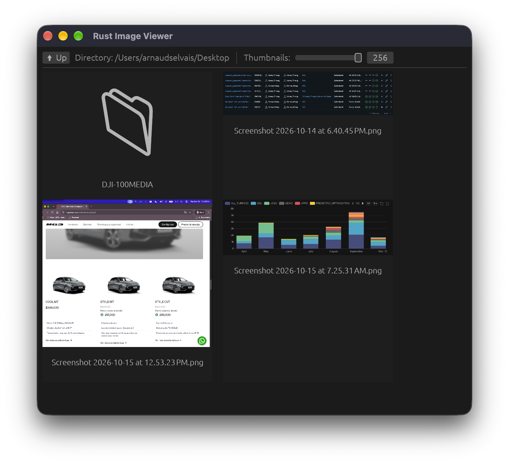
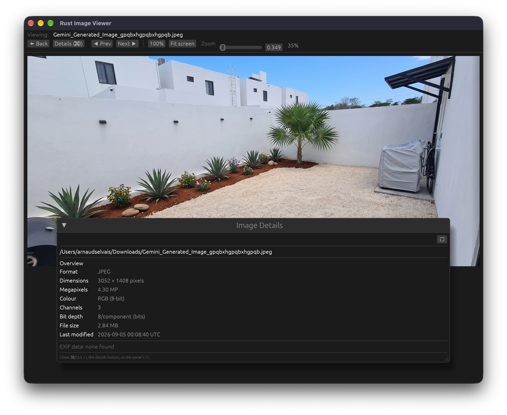

# Rust Image Viewer

A simple and lightweight image viewer written in Rust, built on the `egui`
immediate-mode GUI framework with an optional `EXIF` / metadata inspector.

This is a small project made with all local LLM as a test.
I've mainly used Hermes and qwen3.8:27b on a Mac M3 Max.

I wanted to make a very simple and fast image viewer for windows as I was not happy with the current bloated offering.

## What's new

- **Windows image previews fixed** — thumbnails and the main viewer now load on
  Windows. Before this they showed broken-image placeholders (the red `!` triangles)
  because the `file://` image URI was built from a Windows path (`C:\…`), which
  `egui_extras`' file loader couldn't resolve. Local paths are now normalised to a
  valid `file:///C:/…` URI on Windows; MacOS and Linux were already fine.

## Download latest release

- Mac OS : [rust-image-viewer-macos-universal.app.zip](dist/rust-image-viewer-macos-universal.app.zip) [10.9MB] (22.8MB unpacked)
- Windows: [rust-image-viewer-win-x64.zip](dist/rust-image-viewer-win-x64.zip) [6.4MB] (13.9MB unpacked)

## Screenshots





## Features

- **File Explorer**: navigate directories to find images.
- **Image Viewer**: flip through images with the arrow keys **or** on-screen
  **◀ Prev / Next ▶** buttons in the viewer's top toolbar.
- **Zoom**: a zoom slider, **Fit screen** and **100%** buttons, plus mouse-wheel
  zoom and trackpad pinch (scroll up = zoom in, scroll down = zoom out). When the
  image is larger than the fit window, scroll bars appear so you can pan it.
- **Details panel**: shows format, dimensions, megapixels, colour/channels,
  bit depth, file size, last-modified time, and any EXIF metadata — rendered
  **inside** the main window (no separate OS window).
- **Drag & drop / Open With**: drag a folder or image from the OS (e.g. Finder)
  straight onto the window, or right-click an image (or folder) and pick
  **Open With → Rust Image Viewer…**. A dropped or launched folder is *browsed*
  in the explorer; an image is *opened* for viewing (with its siblings collected
  for ◀ Prev / Next ▶ navigation).
- **App icon**: a custom image icon (`assets/AppIcon…`) appears in the Dock, the
  window title bar, and Launchpad.
- **Fast and lightweight**: Rust + `egui` (GPU-accelerated via wgpu) with
  optimized, stripped release binaries.

## Todo

- simple image resize (and bulk resize)
- Better design for the GUI
- Build for linux
- ...

## Technologies Used

- [Rust](https://www.rust-lang.org/): the core language.
- [egui / eframe](https://github.com/emilk/egui): immediate-mode GUI and its desktop frontend.
- [image](https://github.com/image-rs/image): PNG, JPEG, BMP, GIF, WebP decoding.
- [kamadak-exif](https://github.com/retep0804/kamadak-exif): EXIF metadata parsing.

## Prerequisites

- The **Rust** toolchain via [rustup](https://rustup.rs/) (stable):
  ```bash
  curl --proto '=https' --tlsv1.2 -sSf https://sh.rustup.rs | sh
  ```
- **macOS 12+** or **Windows 10+** for the GUI (uses the Metal / D3D backends).
- A native C/C++ linker is required (Xcode command-line tools on macOS; the
  "Desktop development with C++" workload on Windows).

```bash
# macOS: enable the system linker
xcode-select --install
```

## Getting Started

### 1. Clone the repository

```bash
git clone git@github.com:aselvais/rust-image-viewer.git
cd rust-image-viewer
```

### 2. Run in development

```bash
cargo run                       # opens in your current directory
cargo run -- /path/to/images    # start in a specific folder
```

## Build & Distribute (self-contained binaries)

The release profile is optimized and stripped (`Cargo.toml` → `[profile.release]`:
`opt-level = 2`, `lto`, `codegen-units = 1`, `strip`), so binaries are small and
need no bundled runtime beyond what ships with the OS.

### macOS (local — Apple Silicon or Intel)

```bash
# Optimized single-arch native binary
cargo build --release
open target/release/rust-image-viewer          # or just double-click it

# Self-contained UNIVERSAL .app (arm64 + x86_64) + zip, ad-hoc signed
bash scripts/build-macos.sh            # default: universal
bash scripts/build-macos.sh aarch64    # Apple-Silicon only
bash scripts/build-macos.sh x86_64     # Intel only
# -> dist/rust-image-viewer.app
# -> dist/rust-image-viewer-macos-universal.app.zip
```

The script `lipo`s both architecture slices into one universal Mach-O, wraps it in
`Rust Image Viewer.app` with a minimal `Info.plist`, ad-hoc code-signs it, and zips
it via `ditto`. It also:

- bundles `assets/AppIcon.icns` into the bundle so the app has a proper icon in
  Finder/Dock/Launchpad;
- declares `CFBundleDocumentTypes` so right-click → **Open With → Rust Image
  Viewer…** works for images (and folders) and the app can be set as the default
  handler;
- registers the finished `.app` (and its document types) with Launch Services via
  `lsregister`, so the icon and associations take effect immediately on the
  machine that built it.

The custom icon lives in `assets/` — `AppIcon.svg` is the source of truth; run
`bash scripts/make-icon.sh` to regenerate `AppIcon.png` (embedded at compile time
as the window icon), `AppIcon.icns` (macOS), and `AppIcon.ico` (Windows). For
public distribution over the internet you'd re-sign with an Apple Developer
identity and notarize (ad-hoc signing is fine for local testing only).

> **Windows**: the release `exe` gets its window/taskbar icon at compile time from
> the embedded `assets/AppIcon.png`. Registering the `exe`'s file icon in
> Explorer and its "Open With" file association in the Windows registry is a
> follow-up (no change here); drag-and-drop and the in-app icon already work.

### Windows (build natively on a Windows machine)

> The graphics backend (`wgpu`) links the Win32 Direct3D12 backend, which needs the
> Windows SDK/`link.exe`. There is **no** working cross-toolchain for that from
> macOS/Linux, so a Windows binary must be built on Windows (or in CI — see below).

```powershell
# 1. On Windows: install the VC++ "Desktop development" tools (provides link.exe + SDK)
# 2. Build an optimized release exe
cargo build --release
# -> target\release\rust-image-viewer.exe

# 3. Self-contained: the exe links the MSVC/UCRT runtime dynamically. Either install
#    the "Microsoft Visual C++ Redistributable" on the target machine, or bundle the
#    runtime DLLs next to the exe (recommended) using
#    https://github.com/deluan/deploy , then zip that folder.
```

### Continuous integration (recommended — builds every platform)

A ready-to-use workflow is at `.github/workflows/release.yml`:

```bash
# Build native, self-contained artifacts for Windows + macOS and attach them to a
# GitHub release. Push a version tag to trigger it automatically:
git tag v0.1.0 && git push origin v0.1.0
# (or trigger it manually: Actions → "Release" → "Run workflow".)
```

It produces, per tag:

- `rust-image-viewer-win-x64.zip` — the x64 Windows exe **with the MSVC/UCRT
  runtime DLLs bundled** (via `deploy`) so it runs on a bare Windows install.
- `rust-image-viewer-macos-universal.app.zip` — the universal `.app` (arm64 +
  x86_64), ad-hoc signed, matching `scripts/build-macos.sh`.

## Development

### Running tests

```bash
cargo test
```

### Project structure

- `src/main.rs` — entry point (native window loop, initial directory).
- `src/app.rs` — main application state; hosts the file explorer, the viewer, and the in-window Details panel.
- `src/explorer.rs` — the directory/file explorer.
- `src/viewer.rs` — the image viewer (toolbar, image rendering, zoom, mouse-wheel).
- `src/metadata.rs` — builds the image + EXIF metadata shown in the Details panel.
- `src/utils.rs` — shared helpers (directory listing, etc.).
- `src/explorer_new.rs` — an experimental explorer; **not compiled** (not declared in `main.rs`).
- `scripts/build-macos.sh` — builds and packages the self-contained universal macOS `.app`.
- `scripts/make-icon.sh` — regenerates the app icons (`png`/`icns`/`ico`) from `assets/AppIcon.svg`.
- `assets/` — the custom app icon (`AppIcon.svg` artwork + generated `png`/`icns`/`ico`).
- `.github/workflows/release.yml` — CI that builds self-contained Windows + macOS release artifacts.

## License

Not yet specified — add a `LICENSE` file (e.g. MIT or Apache-2.0) and replace this section.
